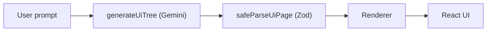

# Gen UI

Type a prompt, and Gemini generates a UI description as JSON. The app validates it with Zod and renders it as React components.

## How it works



1. `generateUiTree` sends the prompt to Gemini together with a JSON Schema, so the model returns structured JSON.
2. `safeParseUiPage` validates the result with the same Zod schema. Invalid output is shown as an error instead of being rendered.
3. `Renderer` walks the validated tree and renders the matching components.

## Tech stack

- Vite, React 19, TypeScript
- Tailwind CSS 4, shadcn/ui (built on `@base-ui/react`)
- Zod 4
- `@google/genai`

## Getting started

```bash
npm install
npm run dev
```

Other scripts:

| Script | Description |
| --- | --- |
| `npm run build` | Type-check and build for production |
| `npm run lint` | Run ESLint |
| `npm run preview` | Preview the production build |

There is no automated test suite yet.

## API key (BYOK)

The app uses your own Gemini API key.

1. Click the settings button in the top-right corner.
2. Paste your Gemini API key and save it.

The key is stored only in your browser's `localStorage` (`src/lib/api-key.ts`) and is sent directly from the browser to Google. It is never sent to another server, and the project does not read it from environment variables, so it cannot end up in the bundle.

Before you generate anything, the page shows a sample UI from `src/mock-response.ts`. You can use it to check the rendering without calling the API.

## Project structure

| Path | Description |
| --- | --- |
| `src/schema/index.ts` | Single source of truth for the UI schema. The Zod schema validates responses and is converted to the JSON Schema sent to Gemini. |
| `src/Renderer.tsx` | Renders a validated `UiPage`. Both `switch` statements have a `never` check, so a missing case is a compile error. |
| `src/lib/llm.ts` | `generateUiTree(prompt, apiKey)`: calls Gemini and holds the system prompt. |
| `src/lib/api-key.ts` | Reads and writes the API key in `localStorage`. |
| `src/App.tsx` | Prompt form, loading and error states, and the result area. |
| `src/mock-response.ts` | Sample UI used before the first generation. |
| `src/components/settings-dialog.tsx` | Dialog for entering the API key. |
| `src/components/ui/` | shadcn/ui components: `button`, `badge`, `alert`, `dialog`, `input`. |
| `src/index.css` | Tailwind setup and the three page themes. |

## Schema overview

- The root node is always `page`. It has an optional `theme`: `default`, `calm`, or `bold`.
- A `page` can contain `stack`, `card`, or any leaf component.
- `stack` and `card` can only contain leaf components. Containers cannot be nested.
- Leaf components: `button`, `text` (`body`, `h1`, `h2`, `h3`), `list`, `badge`, `alert`.

Gemini structured output supports only a subset of JSON Schema, so the schema follows two rules:

- Use `z.enum(["x"])` for fixed values, not `z.literal("x")` (which emits `const`).
- Use `z.union`, not `z.discriminatedUnion` (which emits `oneOf`).

See [AGENTS.md](AGENTS.md) for the reasoning and details.

## Adding a component

1. Add a schema in `src/schema/index.ts` (following the rules above) and include it in `leafNodeSchema`.
2. Add the matching case in `src/Renderer.tsx`.
3. Update the prompt in `src/lib/llm.ts` so the model knows where and when to use it.
4. Add an example to `src/mock-response.ts`.

After adding a component, run one real generation against Gemini. A schema that is too complex can fail with `400 INVALID_ARGUMENT`. See [AGENTS.md](AGENTS.md) for the full checklist, including shadcn CLI checks.
